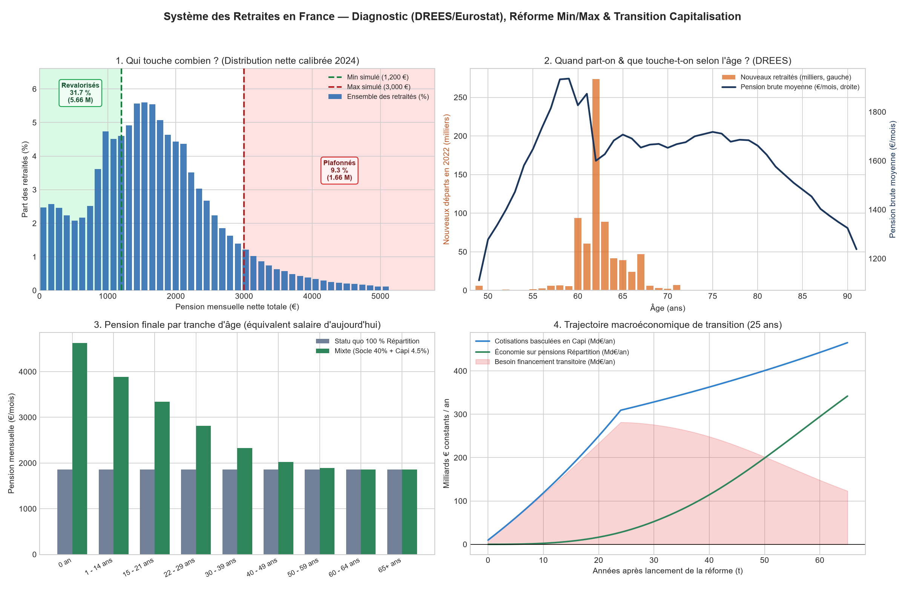
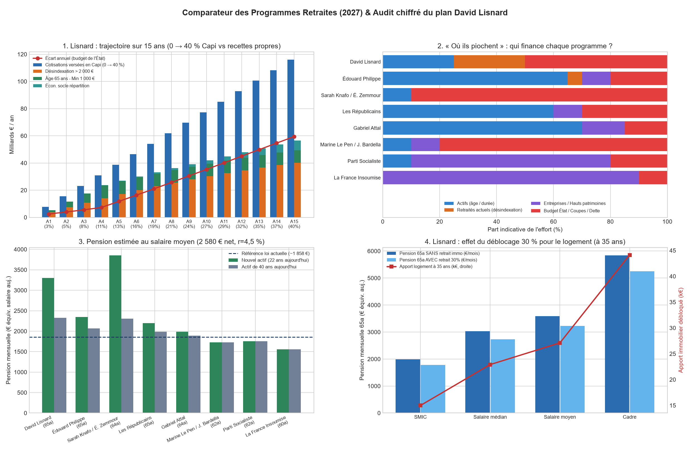

# Retraites : Modélisation, Simulateurs & Comparateur des Réformes

[](https://www.python.org/)
[](https://jupyter.org/)
[](https://data.drees.sante.gouv.fr/)
[](LICENSE)

Outil open-source d'analyse, de modélisation prospective et de comparaison des réformes des retraites en France.  
Ce projet connecte les **données officielles ouvertes les plus fiables** pour simuler les flux financiers du système de retraite, tester des réformes en répartition ou en capitalisation, et auditer de façon chiffrée, neutre et transparente les programmes des candidats à l'élection présidentielle (notamment le plan de passage à 40 % de capitalisation sur 15 ans de **David Lisnard**).

---

## Sommaire

1. [Sources de données officielles](#1-sources-de-données-officielles)
2. [Fonctionnalités principales](#2-fonctionnalités-principales)
3. [Structure du projet](#3-structure-du-projet)
4. [Installation & Prise en main](#4-installation--prise-en-main)
5. [Guide des modules & Notebooks](#5-guide-des-modules--notebooks)
   - [Analyse générale & Simulateurs (`analyse_retraites`)](#analyse-générale--simulateurs)
   - [Comparateur des 8 programmes & Audit Lisnard 15 ans (`comparateur_programmes_retraites`)](#comparateur-des-8-programmes--audit-lisnard-15-ans)
6. [Audit détaillé : transition Lisnard sur 15 ans](#6-audit-détaillé--transition-lisnard-sur-15-ans)
7. [Comparatif transversal des 8 candidats](#7-comparatif-transversal-des-8-candidats)
8. [Méthodologie & Principes de neutralité](#8-méthodologie--principes-de-neutralité)

---

## 1. Sources de données officielles

Tous les modèles et chiffres du projet sont calibrés en temps réel sur les flux officiels ouverts :

| Source | Données extraites | Valeur de calage |
| :--- | :--- | :--- |
| **DREES CPS 2024** (*Comptes de la Protection Sociale*) | Dépenses nationales de retraite et risques vieillesse-survie | **406,02 Md€/an** de pensions strictes (**426,70 Md€** avec réversions et minimum vieillesse) pour **17,89 M** de retraités. |
| **DREES EIR 2020 & ANCETRE** | Distribution détaillée des pensions nettes en 46 tranches, carrières complètes vs incomplètes | Ratio net/brut macro de **90,5 %**, distribution micro-simulée. |
| **DREES EACR 2022 / Comptes des régimes** | Effectifs et masses financières de l'ensemble des caisses de retraite | CNAV, Agirc-Arrco, Fonction publique d'État (SRE), Territoriale et hospitalière (CNRACL), Ouvriers d'État (FSPOEIE), Régimes spéciaux. |
| **DGAFP / Jaunes budgétaires & Cour des comptes** | Ventilation des pensions de la Fonction publique d'État par ministère | **1,93 million** de pensionnés de l'État ventilés entre Éducation nationale, Armées, Intérieur, Justice, Économie/Finances, etc. |
| **Eurostat 2025** (`demo_pjangroup`) | Pyramide des âges par sexe et tranche de 5 ans de la population française | Évaluation des flux démographiques d'actifs et de retraités. |

Un dossier local `cache_api/` conserve une copie conforme des réponses d'API et tableurs ouverts, permettant une exécution **100 % hors-ligne et reproductible**.

---

## 2. Fonctionnalités principales

- **Distribution des pensions (« Qui touche combien ? »)** :
  Visualisation de la distribution nette calibrée 2024, avec calcul automatique du coût d'une pension minimale (ex. 1 000 €, 1 200 €) ou de l'économie d'un plafonnement maximal (ex. 3 000 €).
- **Prise en compte intégrale de la Fonction publique** :
  Analyse séparée des 3 versants de la fonction publique (État civil et militaire, FPT, FPH) et tableau de ventilation par ministère employeur.
- **Simulateur Répartition vs Capitalisation** :
  Modélisation prospective du passage d'un système par répartition vers un modèle mixte (socle $X\,\%$ répartition / $Y\,\%$ capitalisation), avec calcul de l'effort individuel, du capital accumulé à la retraite et de la rente viagère servie, avec ou sans dotation publique à la naissance.
- **Comparateur des 8 programmes présidentiels (2027)** :
  Modélisation paramétrique des propositions de David Lisnard (*Nouvelle Énergie*), Édouard Philippe (*Horizons*), Sarah Knafo / Éric Zemmour (*Reconquête*), Bruno Retailleau (*LR*), Gabriel Attal (*Renaissance*), Jordan Bardella / Marine Le Pen (*RN*), Parti Socialiste (*PS*) et La France Insoumise (*LFI*).
- **Audit de la transition Lisnard sur 15 ans** :
  Chiffrage année par année ($t = 1$ à $15$) de la bascule vers 40 % de capitalisation (cible 116 Md€/an), ventilation précise de *« d'où il pioche »* (désindexation > 2 000 €, âge à 65 ans net du minimum 1 000 €, économies progressives sur le socle), mesure de l'écart à combler par les réductions de dépenses publiques et simulation du déblocage de 30 % du capital pour la résidence principale à 35 ans.

---

## 3. Structure du projet

```
Retraites/
├── analyse_retraites.py                   # Moteur central : connecteur API DREES/Eurostat & simulateurs
├── analyse_retraites.ipynb                # Notebook interactif : analyse macro, distribution & capitalisation
├── analyse_retraites_graphiques.png       # Planche graphique haute résolution (4 panneaux)
├── comparateur_programmes_retraites.py    # Comparateur des 8 candidats & audit Lisnard 15 ans
├── comparateur_programmes_retraites.ipynb # Notebook interactif : comparateur des réformes & audit 15 ans
├── comparateur_programmes_graphiques.png  # Planche graphique du comparateur et de la transition
├── cache_api/                             # Cache local des jeux de données DREES & Eurostat
│   ├── cps_prestations_2024.json
│   ├── cps_regimes_2024.json
│   ├── eir2020_xlsx.xlsx
│   ├── effectifs_2022_xlsx.xlsx
│   ├── eurostat_pop_fr.json
│   └── ...
├── requirements.txt                       # Dépendances Python nécessaires
├── .gitignore                             # Fichiers exclus du suivi git
└── README.md                              # Documentation complète du projet
```

---

## 4. Installation & Prise en main

### Prérequis
- Python 3.10 ou supérieur
- `git`

### 1. Cloner le dépôt
```bash
git clone https://github.com/jeanbenard76/Retraites.git
cd Retraites
```

### 2. Installer les dépendances
```bash
pip install -r requirements.txt
```

### 3. Exécuter les scripts en ligne de commande (CLI)

#### Lancer l'analyse macro et la simulation répartition / capitalisation :
```bash
python analyse_retraites.py --min-pension 1200 --max-pension 3000 --socle-repartition 60 --dotation-naissance
```

#### Lancer le comparateur des 8 programmes et l'audit Lisnard :
```bash
python comparateur_programmes_retraites.py --duree-transition 15 --seuil-desidx 2000 --inflation 1.8
```

#### Options en ligne de commande disponibles :
- `--duree-transition <ans>` : Durée de montée vers la capitalisation (défaut : 15 ans).
- `--seuil-desidx <eur>` : Seuil net mensuel de gel des pensions (défaut : 2 000 €).
- `--inflation <pct>` : Hypothèse d'inflation annuelle (défaut : 1.8 %).
- `--gel-marginal` : Désindexer uniquement la fraction de pension dépassant le seuil (au lieu du gel total au-dessus du seuil).
- `--rendement <pct>` : Rendement réel net d'inflation des fonds de capitalisation (défaut : 4.5 %).
- `--refresh-cache` : Forcer le re-téléchargement direct des APIs DREES et Eurostat.

---

## 5. Guide des modules & Notebooks

### Analyse générale & Simulateurs (`analyse_retraites`)
Le carnet [`analyse_retraites.ipynb`](./analyse_retraites.ipynb) et le script [`analyse_retraites.py`](./analyse_retraites.py) regroupent :
1. **L'interrogation des API ouvertes DREES & Eurostat** avec gestion automatique du cache local.
2. **L'analyse « Qui touche combien ? »** : distribution des pensions nettes en France avec zones colorées paramétrables (fond vert pour les revalorisations, fond rouge pour les plafonnements).
3. **Le tableau complet de la Fonction publique** : comparaison Fonction publique civile d'État, Militaires, CNRACL (territoriale et hospitalière), ouvriers d'État et régimes spéciaux.
4. **La ventilation par ministère employeur** des pensions directes versées par l'État.
5. **Le simulateur de capitalisation** : calcul de la pension future pour différentes tranches d'âge actuelles (20 à 60 ans) et nouveaux arrivants, avec calcul de l'impact d'une dotation à la naissance.



---

### Comparateur des 8 programmes & Audit Lisnard 15 ans (`comparateur_programmes_retraites`)
Le carnet [`comparateur_programmes_retraites.ipynb`](./comparateur_programmes_retraites.ipynb) et le script [`comparateur_programmes_retraites.py`](./comparateur_programmes_retraites.py) mettent en regard de façon objective :
- L'impact budgétaire brut et net à horizon 10 ans de chaque programme.
- La part de l'effort demandée aux actifs (âge / durée), aux retraités actuels (désindexation), aux entreprises/hauts patrimoines (impôts) ou au budget général de l'État (coupes budgétaires).
- La pension nette mensuelle finale estimée pour un jeune actif de 22 ans et un salarié de 40 ans au salaire moyen (2 580 € net).



---

## 6. Audit détaillé : transition Lisnard sur 15 ans

David Lisnard (*Nouvelle Énergie*) propose de transformer le système en un modèle **60 % répartition / 40 % capitalisation** en 8 tranches étalées sur **15 ans** :

- **Âge légal** : 65 ans.
- **Socle garanti** : 1 000 € net/mois dès 65 ans financé par répartition.
- **Flux de capitalisation cible** : **116 Md€/an** (soit 40 % du socle contributif direct, équivalant à 162,4 Md€ si appliqué sur toute la masse DREES).

### Trajectoire financière année par année ($t = 1$ à $15$)

| Année | % Capi | Flux Capi (cible 116 Md€) | 1. Désindexation > 2 000 € | 2. Solde 65a − Min 1 000 € | 3. Écon. socle répartition | Total ressources propres | Écart annuel (Budget de l'État) | Cumul État sur 15 ans | Taux de couverture propre |
| :---: | :---: | :---: | :---: | :---: | :---: | :---: | :---: | :---: | :---: |
| **An 1** | **2,7 %** | 7,7 Md€ | 3,8 Md€ | +1,4 Md€ | 0,01 Md€ | **5,2 Md€** | **+2,5 Md€** | 2,5 Md€ | **67,8 %** |
| **An 2** | **5,3 %** | 15,5 Md€ | 7,4 Md€ | +4,1 Md€ | 0,05 Md€ | **11,5 Md€** | **+3,9 Md€** | 6,4 Md€ | **74,5 %** |
| **An 3** | **8,0 %** | 23,2 Md€ | 10,9 Md€ | +6,7 Md€ | 0,12 Md€ | **17,7 Md€** | **+5,5 Md€** | 12,0 Md€ | **76,1 %** |
| **An 4** | **10,7 %** | 30,9 Md€ | 14,1 Md€ | +9,3 Md€ | 0,24 Md€ | **23,7 Md€** | **+7,3 Md€** | 19,3 Md€ | **76,5 %** |
| **An 5** | **13,3 %** | 38,7 Md€ | 17,2 Md€ | +9,3 Md€ | 0,41 Md€ | **26,9 Md€** | **+11,8 Md€** | 31,0 Md€ | **69,6 %** |
| **An 6** | **16,0 %** | 46,4 Md€ | 20,1 Md€ | +9,3 Md€ | 0,65 Md€ | **30,1 Md€** | **+16,3 Md€** | 47,3 Md€ | **64,8 %** |
| **An 7** | **18,7 %** | 54,1 Md€ | 22,9 Md€ | +9,3 Md€ | 0,96 Md€ | **33,1 Md€** | **+21,0 Md€** | 68,3 Md€ | **61,2 %** |
| **An 8** | **21,3 %** | 61,9 Md€ | 25,5 Md€ | +9,3 Md€ | 1,36 Md€ | **36,2 Md€** | **+25,7 Md€** | 94,1 Md€ | **58,4 %** |
| **An 9** | **24,0 %** | 69,6 Md€ | 28,0 Md€ | +9,3 Md€ | 1,84 Md€ | **39,1 Md€** | **+30,5 Md€** | 124,5 Md€ | **56,2 %** |
| **An 10** | **26,7 %** | 77,3 Md€ | 30,3 Md€ | +9,3 Md€ | 2,43 Md€ | **42,0 Md€** | **+35,3 Md€** | 159,8 Md€ | **54,4 %** |
| **An 11** | **29,3 %** | 85,1 Md€ | 32,5 Md€ | +9,3 Md€ | 3,12 Md€ | **44,9 Md€** | **+40,1 Md€** | 200,0 Md€ | **52,8 %** |
| **An 12** | **32,0 %** | 92,8 Md€ | 34,6 Md€ | +9,3 Md€ | 3,93 Md€ | **47,8 Md€** | **+45,0 Md€** | 244,9 Md€ | **51,5 %** |
| **An 13** | **34,7 %** | 100,5 Md€ | 36,6 Md€ | +9,3 Md€ | 4,85 Md€ | **50,7 Md€** | **+49,8 Md€** | 294,8 Md€ | **50,4 %** |
| **An 14** | **37,3 %** | 108,3 Md€ | 38,4 Md€ | +9,3 Md€ | 5,90 Md€ | **53,6 Md€** | **+54,7 Md€** | 349,4 Md€ | **49,5 %** |
| **An 15** | **40,0 %** | **116,0 Md€** | **40,1 Md€** | **+9,3 Md€** | **7,09 Md€** | **56,5 Md€** | **+59,5 Md€** | **408,9 Md€** | **48,7 %** |

### Les enseignements de l'audit
1. **D'où pioche-t-il ?**
   - **La désindexation > 2 000 € net** rapporte de **3,8 Md€** (An 1) à **40,1 Md€/an** (An 15). C'est le pilier financier n°1.
   - **L'âge à 65 ans net du minimum 1 000 €** apporte un gain net pérenne de **+9,3 Md€/an** dès l'An 4 (+10,5 Md€ brut d'économies moins 1,2 Md€ pour le socle garanti aux carrières complètes).
   - **Les économies de socle par renouvellement de génération** démarrent à 0,01 Md€ et atteignent **7,1 Md€/an** en An 15.
2. **Comment est comblé l'écart transitoire ?**
   - Pendant les 4 premières années, les recettes propres couvrent **68 % à 76 %** du besoin : l'effort budgétaire annuel reste modéré (de 2,5 à 7,3 Md€/an).
   - Entre l'An 5 et l'An 15, la divergence s'accélère car les cotisations détournées atteignent 116 Md€ alors que la baisse des pensions en répartition ne fait que commencer. L'écart annuel monte à **35,3 Md€** (An 10) et **59,5 Md€** (An 15).
   - Sur l'ensemble des 15 ans, le **besoin cumulé s'élève à 408,9 Md€** (soit une moyenne de **~27,3 Md€/an**).
   - David Lisnard compense cet écart par son plan d'économies de **100 à 120 Md€ de baisse des dépenses publiques**. Le plan est donc cohérent avec son cadrage budgétaire, sous réserve que l'État maintienne ces économies de structure avec constance pendant 15 ans.
3. **Option déblocage pour la résidence principale (-30 % à 35 ans)** :
   - Pour un salarié au salaire moyen (2 580 € net), cette clause permet de débloquer **27 104 € d'apport personnel** à 35 ans.
   - À 65 ans, la pension finale s'établit à **3 227 €/mois** (au lieu de 3 588 € sans retrait), restant nettement au-dessus du système actuel (~1 858 €/mois).

---

## 7. Comparatif transversal des 8 candidats

| Candidat / Bloc | Âge cible | Annuités | Répart. / Capi. | Minimum visé | Où il pioche (financement principal) | Solde net t+10a | Pension actif 22a | Pension actif 40a |
| :--- | :---: | :---: | :---: | :---: | :--- | :---: | :---: | :---: |
| **David Lisnard** (*Droite libérale*) | 65 ans | 43 | 60 / 40 % | 1 000 € | Désindexation > 2 000 € + 65 ans + coupes dépenses État | −85,5 Md€ | 3 302 € | 2 325 € |
| **Édouard Philippe** (*Centre droit*) | 65 ans | 45 | 85 / 15 % | — | Âge à 65 ans + 45 annuités + abondement PER jeunes | −14,5 Md€ | 2 344 € | 2 065 € |
| **Sarah Knafo / É. Zemmour** (*Reconquête*) | 64 ans | 43 | 0 / 100 % | 1 100 € | Plan d'économies publiques affiché (140 Md€) | −82,4 Md€ | 3 853 € | 2 309 € |
| **Les Républicains** (*Droite républicaine*) | 65 ans | 43 | 90 / 10 % | 1 100 € | Âge légal à 64-65 ans + fonds souverain | −12,1 Md€ | 2 198 € | 1 988 € |
| **Gabriel Attal** (*Bloc central*) | 64 ans | 43 | 95 / 5 % | — | 43 annuités (fin âge rigide) + PER incitatif | −8,5 Md€ | 1 988 € | 1 892 € |
| **Marine Le Pen / J. Bardella** (*RN*) | 62 ans | 42 | 100 / 0 % | 1 200 € | Économies immigration/UE/fraude + salaires | −3,0 Md€ | 1 723 € | 1 723 € |
| **Parti Socialiste** (*Gauche réformiste*) | 62 ans | 43 | 100 / 0 % | 1 300 € | Fiscalité capital/superprofits + FRR | −2,0 Md€ | 1 754 € | 1 754 € |
| **La France Insoumise** (*Gauche radicale*) | 60 ans | 40 | 100 / 0 % | 1 426 € | Cotisations patronales + fin exonérations + taxe capital | −4,0 Md€ | 1 558 € | 1 558 € |

*(Pensions simulées en euros équivalent pouvoir d'achat d'aujourd'hui pour un salaire net de référence de 2 580 € net/mois et un rendement réel net d'inflation de 4,5 %).*

---

## 8. Méthodologie & Principes de neutralité

1. **Données institutionnelles publiques** :  
   Toutes les données de calage proviennent de la [DREES](https://drees.solidarites-sante.gouv.fr/) (*Direction de la recherche, des études, de l'évaluation et des statistiques*) et d'[Eurostat](https://ec.europa.eu/eurostat).
2. **Neutralité scientifique et politique** :  
   Les propositions de chaque candidat sont modélisées d'après leurs programmes officiels et déclarations publiques. Les impacts financiers sont systématiquement recalculés avec les mêmes règles démographiques et actuarielles, sans porter de jugement de valeur politique.
3. **Transparence et reproductibilité** :  
   Tous les calculs sont disponibles en code Python pur et documentés cellule par cellule dans les Jupyter Notebooks.

---

## Licence

Projet distribué sous licence MIT. Libre d'utilisation, de modification et de diffusion à des fins de recherche, d'information publique et d'analyse citoyenne.
